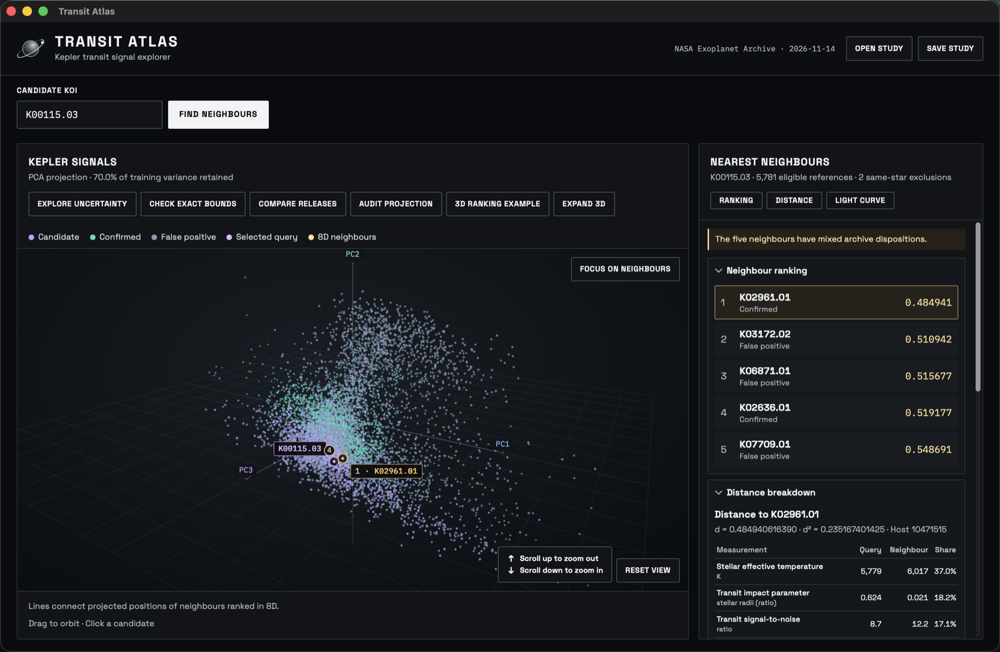
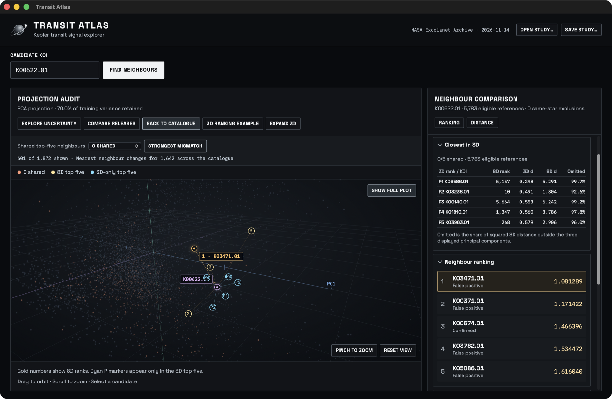
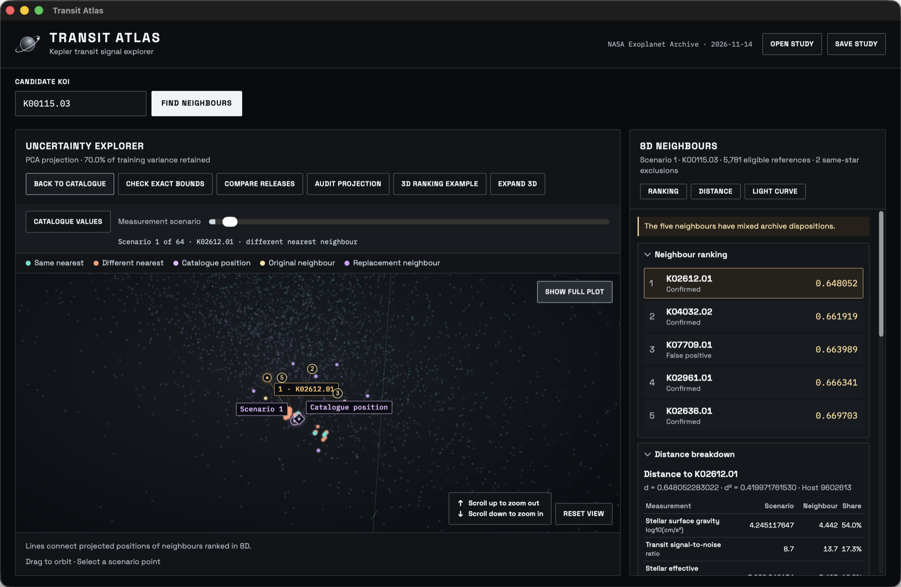
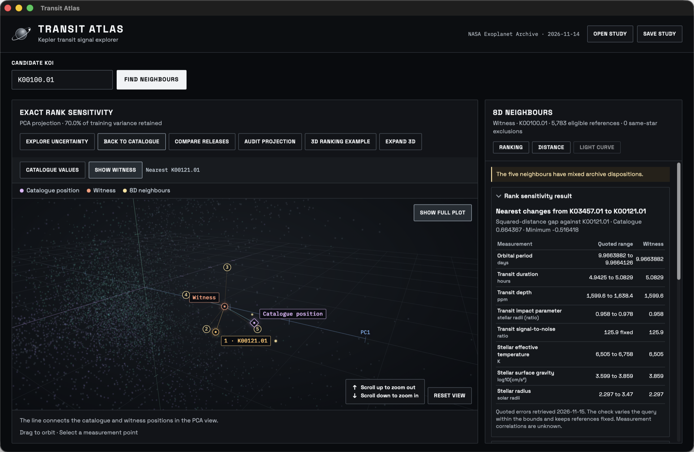
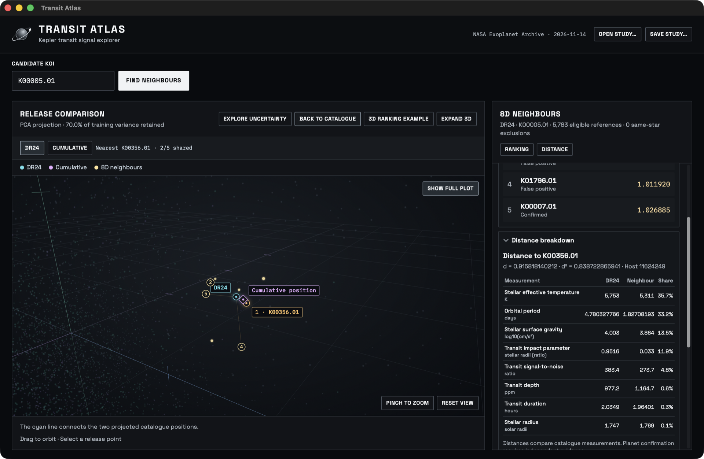
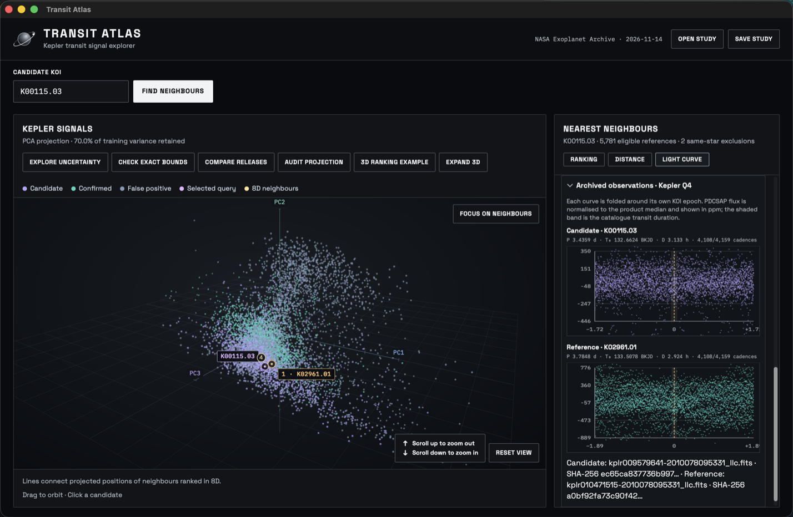
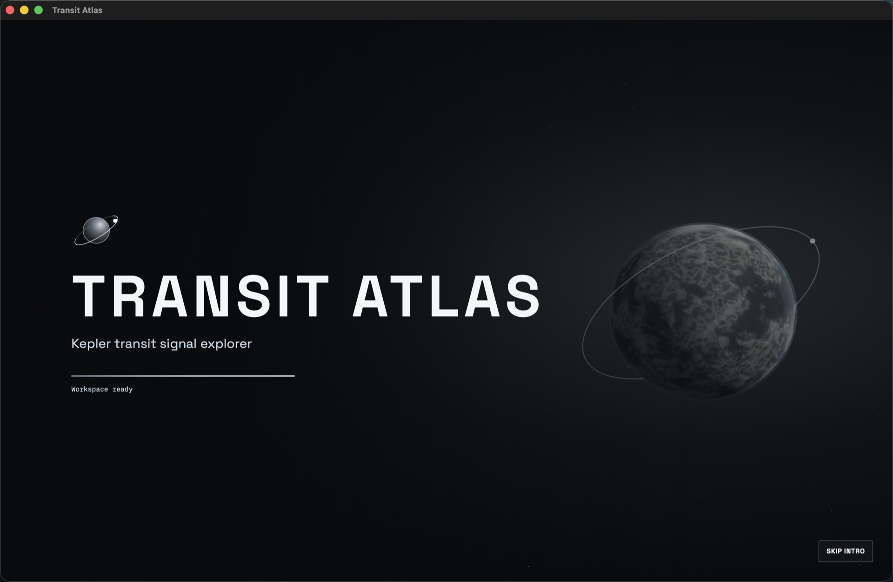

# Transit Atlas

Transit Atlas is an offline macOS workbench for exploring NASA’s Kepler transit signals in 3D. Select a candidate, find its five nearest neighbours across eight archive measurements, and see how each measurement contributes to the distance. Explore how the ranking changes within the candidate’s quoted measurement ranges or between catalogue releases.

The projection audit found **601 of 1,872 candidates** whose five closest references in the 3D view and in the full measurement space had nothing in common.

## Table of contents

- [Run on macOS](#run-on-macos)
- [Explore the catalogue](#explore-the-catalogue)
  - [Audit the 3D projection](#audit-the-3d-projection)
  - [Explore measurement uncertainty](#explore-measurement-uncertainty)
  - [Check exact rank sensitivity](#check-exact-rank-sensitivity)
  - [Compare catalogue releases](#compare-catalogue-releases)
  - [Save and replay a study](#save-and-replay-a-study)
  - [Inspect archived light curves](#inspect-archived-light-curves)
- [Opening and walkthrough](#opening-and-walkthrough)
- [Verify the calculations](#verify-the-calculations)
- [Technical documentation](#technical-documentation)
- [Project layout](#project-layout)



## Run on macOS

Install Xcode or the Xcode Command Line Tools, stable Rust and Bun. Clone the repository and run the following commands.

```bash
git clone https://github.com/richardwaters9049/Transit_Atlas.git
cd Transit_Atlas
(cd desktop && bun install --frozen-lockfile)
bun run tauri dev
```

The app preloads the catalogue and the first ranking during a 5.4-second orbital flyby. Select **Skip intro** or press **Escape** to enter sooner. The opening respects the system reduced-motion preference. The catalogue and fonts are bundled for offline use after setup.

## Explore the catalogue

Search by Kepler Object of Interest (KOI) ID or click a candidate in the plot. Drag to orbit. Scroll up to zoom out or down to zoom in. Select **Focus on neighbours** to frame the query and its five nearest matches. Click a ranked neighbour to open its distance breakdown. **Expand 3D** opens the live scene in a full-window view and preserves the camera when you return.

The three displayed principal components retain 70.0% of training variance. Rust ranks neighbours using all eight standardised measurements and excludes signals that share the query’s star. Open **3D ranking example** for a small demonstration of how the ranking changes when dimensions are dropped. Archive labels describe the catalogue’s dispositions. Planet confirmation requires independent evidence. [Data and methods](docs/methods.md)

### Audit the 3D projection

Select **Audit projection** to compare the three-component and eight-dimensional rankings for all 1,872 candidates. Filter the 3D map by how many neighbours the two top-five lists share. The inspector shows the projected distance, full distance, full rank and share of squared distance omitted by the projection for each of the five closest points in 3D.

Start with `K00115.03`. Its closest reference in 3D, `K08264.01`, ranks 1,836th in eight dimensions. **Strongest mismatch** jumps to `K00622.01`, where the closest point in 3D ranks 5,157th overall. **Focus on both rankings** frames the selected candidate and both sets of neighbours. [Projection audit method](docs/methods.md#projection-audit)



### Explore measurement uncertainty

Select **Explore uncertainty** to calculate 64 scenarios within the candidate’s available quoted ranges. Click a point or move the slider to inspect the measurements and ranking for that scenario. For `K00115.03`, scenario 1 changes the nearest neighbour from `K02961.01` to `K02612.01`. Select **Catalogue values** to return to the original measurements.



### Check exact rank sensitivity

Search for `K00100.01` and select **Check exact bounds**. The app compares the nominal nearest reference with every eligible challenger over the full box of quoted measurement ranges. It found a set of values that changes the 8D winner from `K03457.01` to `K00121.01`. All 64 sampled scenarios keep the original winner. Use **Catalogue values** and **Show witness** to switch between their 3D positions, measurements and rankings.

The inspector lists the bounds and the smallest squared-distance gap against the displayed challenger. A gap within the numerical tolerance is reported as a near tie. The bounds vary the query while the reference measurements stay fixed. [Derivation and independent reproduction](docs/research-roadmap.md#checked-example-from-the-current-data)



### Compare catalogue releases

Search for `K00005.01` and select **Compare releases**. Switch between **DR24** and **Cumulative** to see the same signal’s reported measurements and the resulting rankings against a fixed reference set. Its nearest neighbour changes from `K00356.01` to `K01090.01`, and two of the five neighbours are shared.



### Save and replay a study

**Save study…** records the candidate, selected neighbour, active scenario, exact-bound result, release or projection filter, and camera in a portable `.atlas.json` file. The file includes the projected positions and eight-dimensional distance contributions. Version 2 studies also retain the selected Kepler product identity, signal ephemeris and processing fingerprint. **Open study…** verifies those fingerprints and recalculates the evidence before restoring the view. Version 1 studies remain readable; they predate the light-curve replay check. [Study format and replay contract](docs/study-files.md).

A replayable exact-rank example is included at [`data/studies/2026-11-15-K00100-exact-witness.atlas.json`](data/studies/2026-11-15-K00100-exact-witness.atlas.json). It opens on `K00100.01` with the witness for `K00121.01` selected. Save your own investigations in `data/studies/` or another location of your choice.

### Inspect archived light curves

Search for K00115.03. The inspector includes phase-folded Kepler Q4 observations for the candidate and its nominal nearest reference, K02961.01. Each series is folded around its own NASA Exoplanet Archive ephemeris. The display uses median-normalised PDCSAP flux in ppm and marks the catalogue transit duration.

The original DR25 FITS products, ephemeris snapshot, product URIs, SHA-256 checksums and derived cadence arrays are stored with the project. The plotted documents can be replayed offline and are checked against their original FITS files by the Python test suite. [Light-curve mathematics and provenance](docs/light-curves.md)



## Opening and walkthrough



[3D workflow walkthrough](docs/videos/Transit_Atlas_3D_Walkthrough.mp4) · [Original desktop demo](docs/videos/Transit_Atlas_Demo.mp4)

## Verify the calculations

Use Python 3.12 or newer. Run these commands from the repository root.

```bash
python3 -m venv .venv
source .venv/bin/activate
python -m pip install -r reference/requirements.txt
python reference/transit_atlas.py --query K00115.03
python reference/transit_atlas.py --synthetic
python -m unittest discover -s reference -v
cargo test -p atlas-core --locked
(cd desktop && bun run test && bun run build)
cargo test --manifest-path desktop/src-tauri/Cargo.toml
```

On an interactive macOS desktop, run `bun run test:macos-ui` to build the app and exercise native study Save/Open, 3D camera restoration and fingerprint-failure preservation. Close Transit Atlas first and grant Accessibility permission to the terminal or automation host. See [the GUI harness notes](docs/validation/macos-study-ui-harness.md).

For an uncertainty report in the terminal, run `cargo run --locked -p atlas-core --example stability -- K00115.03 K00005.01`. Launch with `TRANSIT_ATLAS_TRACE=1 bun run tauri dev` to print a summary when the app checks sampled or exact uncertainty, compares releases or audits the projection.

To rebuild the pinned Kepler Q4 examples, run these from the repository root:

```bash
python reference/import_kepler_lightcurve.py --koi-id K00115.03 --role candidate --quarter 4 --overwrite
python reference/import_kepler_lightcurve.py --koi-id K02961.01 --role reference --quarter 4 --overwrite
```

The importer uses the committed NASA Exoplanet Archive ephemeris snapshot and MAST's public AWS mirror. Pass --fits /path/to/product_llc.fits to use a previously downloaded FITS file instead.

The held-out evaluation tested `k = 3, 5, 7` and selected `k = 5` on validation stars. It agreed with 704 of 776 usable held-out archive labels (90.7%), compared with 59.7% for the training majority baseline. The majority baseline had higher raw agreement at signal-to-noise ratios below 10. [Evaluation protocol and failure cases](docs/evaluation.md)

## Technical documentation

Start with the [documentation index](docs/README.md) for a guided route through the science and implementation.

- [K-nearest neighbours](docs/knn.md) explains the KNN method, the exact five-neighbour search, why `k = 5` was selected and how the held-out classifier evaluation differs from the app's exploratory lookup.
- [Linear algebra](docs/linear-algebra.md) introduces the vectors, matrices, standardisation, Euclidean metric, feature contributions, PCA and SVD used by the project.
- [The eight-dimensional feature space](docs/eight-dimensional-space.md) documents all eight axes, source fields, units, transforms, scaling and the distinction between the full 8D ranking and the 3D display.
- [Mathematics](docs/mathematics.md) provides the detailed derivations, worked Kepler calculation and sensitivity mathematics.
- [Data and methods](docs/methods.md) records catalogue coverage, feature definitions and the projection audit.
- [Kepler light curves](docs/light-curves.md) defines the KOI-to-KIC mapping, BKJD phase folding, flux normalisation, quality filtering and provenance contract.
- [Held-out evaluation](docs/evaluation.md) describes the host-based protocol, baselines and failure cases.
- [Research roadmap](docs/research-roadmap.md) derives the exact check, reproduces a ranking-change witness and tracks the archived-observation integration.

## Project layout

| Path | Contents |
| --- | --- |
| `crates/atlas-core/` | Rust scaling, neighbour search, sampled and exact uncertainty, release comparison and parity tests |
| `desktop/src/` | TypeScript workspace, Three.js scenes and Motion transitions |
| `desktop/src-tauri/` | Tauri window, Rust commands and study file handling |
| `reference/` | Python reference, automated tests, evaluation, FITS ingestion and phase-fold calculations |
| `data/raw/` | Pinned NASA extracts, ephemerides, original Kepler FITS products and checksums |
| `data/generated/` | Catalogue, comparison data and reproducible folded light-curve documents bundled with the app |
| `data/studies/` | Portable `.atlas.json` example investigations that can be reopened in the app |
| `data/fixtures/`, `data/evaluation/` | Verified lookup fixture and held-out results |
| `docs/` | KNN, linear algebra, eight-dimensional feature space, mathematical derivations, scientific methods, evaluation, light curves and research records |

The pinned cumulative table contains 9,564 Kepler signals. Of these, 9,199 have usable values for all eight measurements, including 1,872 candidates. The [snapshot manifest](data/raw/kepler-koi-cumulative-2026-11-14.json) records the query, retrieval date and SHA-256 checksum. [NASA Exoplanet Archive cumulative catalogue](https://doi.org/10.26133/NEA4)
